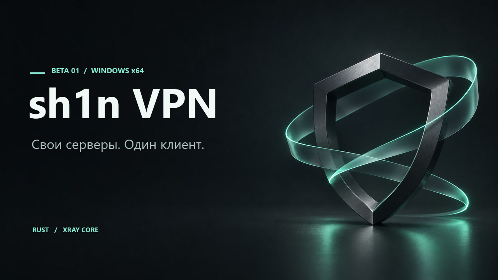
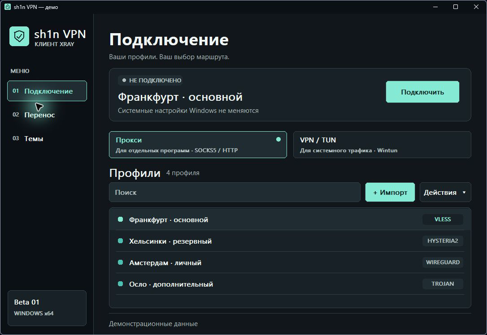

# sh1n VPN

**Свои серверы. Один нативный клиент для Windows.**

Перенесите профили из Happ или v2rayN, выберите прокси для отдельных программ или TUN для всего компьютера. sh1n VPN — портативный клиент на Rust и Xray, без встроенного браузера. Подписку или сервер вы выбираете сами.

[**Скачать для Windows x64**](https://github.com/d1rtym0lly/sh1n-VPN/releases/download/v0.2.0-beta.1/sh1n-VPN-v0.2.0-beta.1-Windows-x64.zip) · [Инструкция](docs/usage.md) · [Проморолик, MP4](https://github.com/d1rtym0lly/sh1n-VPN/releases/download/v0.2.0-beta.1/sh1n-VPN-beta-preview.mp4)

## Что есть в бете

- **Перенос одним списком.** Открытые HTTPS-подписки, текст и Base64, файлы Xray JSON, ссылки v2rayN и WireGuard .conf. Профили можно перетаскивать в окно.
- **Экспорт без привязки к клиенту.** Сохраните один профиль или весь список в Xray JSON. Рабочая копия защищена Windows DPAPI; экспортированный JSON содержит ключи в открытом виде.
- **Два режима.** Локальный SOCKS5/HTTP не меняет маршруты Windows. TUN обрабатывает системный трафик через Wintun и требует прав администратора.
- **Нативный интерфейс.** Поиск профилей, горячие клавиши, русские подписи и [10 палитр](THEMES.md), включая светлые.

[Посмотреть экран импорта](media/app-transfer.png) · [Посмотреть темы](media/app-themes.png)

## Что можно подключить

| Откуда | Поддержка |
|---|---|
| Happ | Открытые подписки и доступные ссылки/JSON, без вмешательства в Happ |
| v2rayN / v2rayNG | Стандартные ссылки и распространённые внутренние форматы v2rayN |
| Ссылки | VLESS/REALITY, VMess, Trojan, Shadowsocks, SOCKS5, Hysteria2, WireGuard |
| Конфиги | Xray JSON с поддерживаемыми outbounds, включая HTTP и MASQUE; WireGuard .conf |

Это не универсальный VPN-движок: OpenVPN, IKEv2, TUIC и AnyTLS пока не поддерживаются. Закрытые профили Happ и внутренние группы v2rayN не извлекаются. У импорта сложных JSON есть [ограничения](docs/usage.md).

## Запуск

1. Распакуйте весь ZIP, не отделяя папку **core** от **sh1n VPN.exe**.
2. Откройте **Перенос**. Вставьте доступную ссылку или откройте файл.
3. Выберите профиль и нажмите **Подключить**. Для режима прокси скопируйте показанные адрес и порт в настройки нужной программы.

Это **бета** для Windows 10/11 x64. Пакет не подписан. Проверьте SHA-256 из Assets и скачивайте сборку с этой страницы. VPN-сервера не входят в комплект. Другие ОС пока не выпущены.

## Для разработчиков

Сборка из PowerShell: **.\build.ps1**. Нужен Rust для Windows x64; GNU-таргет требует MinGW/GCC, MSVC — Visual Studio Build Tools. Скрипт запускает тесты и проверяет SHA-256 официального комплекта [Xray-core 26.11.9](https://github.com/XTLS/Xray-core/releases/tag/v26.11.9). В пакет включены лицензии Xray, Wintun и зависимости Rust.

Опции собранного приложения: **--check-core** проверяет синтаксис конфигураций, **--smoke-proxy** проводит локальный сквозной тест HTTP/SOCKS5 через VLESS, **--showcase home|transfer|themes** открывает безопасный деморежим с вымышленными профилями.

[Сообщить об ошибке](https://github.com/d1rtym0lly/sh1n-VPN/issues/new) — укажите версию Windows, протокол и шаги. Не прикладывайте ссылки подписок, ключи, приватные конфиги или файлы профилей.
